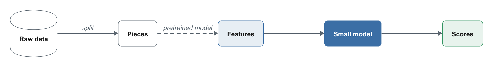
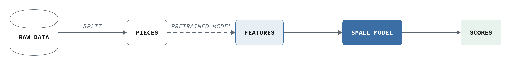

# D2 theme — minimal

One import gives every D2 diagram the same palette, geometry and vocabulary as the `phd` and `work` slide
themes. Tested with D2 v0.9.0.

```
d2/
├── theme.d2                light, Arial   ← import this on white / tint slides
├── theme-dark.d2           dark, Arial    ← import this on dark slides
├── theme-terminal.d2       light, Terminal look (monospace, UPPERCASE labels)
├── theme-terminal-dark.d2  dark, Terminal look
├── core.d2                 shared defaults + classes (imported by the themes; do not import directly)
├── d2t.ps1                 Windows wrapper: Arial embedding + Tala layout
├── d2t.cmd                 Windows shim: runs d2t.ps1 with -ExecutionPolicy Bypass (used by the VS Code task)
├── d2t.sh                  macOS wrapper: Arial embedding + Tala layout
├── examples/               pipeline · fix-tiers · data-model
└── previews/               rendered examples (svg + png), including pipeline-terminal{,-dark}
```

## 1. Use it

After running the repo's setup (see the root README), type `d2theme` in any `.d2` file. The snippet inserts
the import for this machine, a quoted absolute path to the `~/.d2/themes` link:

```d2
...@"C:/Users/<you>/.d2/themes/theme"     # or theme-dark / theme-terminal / theme-terminal-dark

data: Raw data {class: store}
feat: Features {class: primary}
model: Small model {class: primary-solid}
data -> feat -> model
```

Two D2 behaviours (checked on v0.9.0) shape this:

- **`~` is not expanded** in imports, and an unquoted absolute path does not parse. Hence the quoted path,
  and the snippet so you never type it.
- **A diagram's own relative imports resolve against the current directory**, not the file's folder.
  `d2 examples/pipeline.d2` from `d2/` fails; run it from `d2/examples/`. Imports *inside* an imported theme
  resolve next to that theme, so the absolute import above works from anywhere.

Render with `d2t`, which embeds Arial and uses the Tala layout engine:

```bash
d2t figures/pipeline.d2 figures/pipeline.svg
d2t --watch figures/pipeline.d2 figures/pipeline.svg   # live reload
d2t --layout elk figures/pipeline.d2 figures/pipeline.svg   # --layout / -l / D2_LAYOUT override Tala
```

Or from VS Code: `Ctrl+Shift+P` → **Tasks: Run Task** → **house-style: Export D2 to SVG (Tala + Arial)**.

Put it in a slide: ``. The background is transparent, so the figure sits on white,
tint or dark slides, and the slide theme centres and fits it. Use a `-dark` theme on `dark`, `title` and
`divider` slides.

### Terminal look

`theme-terminal` and `theme-terminal-dark` keep the house palette, classes and geometry, and switch on D2's
built-in **Terminal** theme (id 300) for monospace, UPPERCASE labels. Each is two lines: it imports
`theme` / `theme-dark` and sets `theme-id: 300`, so colours live in one place. The Terminal font stays even
through `d2t` (which passes Arial). Pick it per diagram with the `d2theme-terminal` snippets.

| Arial (`theme`) | Terminal (`theme-terminal`) |
|---|---|
|  |  |

## 2. Palette (the 12 hues you get)

| Token | Light | Dark | Origin |
|---|---|---|---|
| `${pal.ink}` text | `#1A1A1A` | `#FFFFFF` | phd Ink / Paper |
| `${pal.muted}` labels, secondary | `#5B6670` | `#A8A8A8` | phd Slate |
| `${pal.line}` strokes, arrows | `#5B6670` | `#8E979F` | phd Slate |
| `${pal.mist}` group fill | `#F4F6F7` | `#232323` | phd Mist |
| `${pal.paper}` card fill | `#FFFFFF` | `#2A2A2A` (card) | phd Paper / Ink lifted 7% |
| `${pal.primary}` | `#3B6EA5` | `#7FDCC8` | phd Blue / Mint |
| `${pal.secondary}` | `#6C4BC9` | `#BD93F9` | work purple / lilac |
| `${pal.ok}` | `#3F9B6B` | `#50FA7B` | phd Green / work neon |
| `${pal.warn}` | `#F2A93C` | `#F2C230` | phd Amber / Yellow |
| `${pal.danger}` | `#C1512F` | `#FFB86C` | phd Rust / work orange |

Each accent also has `-soft` (a tint: accent at 12% on white, 16% on the dark ground). Work teal and pink
were dropped to keep the set small [design]. The tokens are ordinary D2 variables, so your own diagrams can
use them: `x.style.fill: ${pal.secondary-soft}`.

## 3. Classes (the only way colour enters a diagram)

| Class | Use |
|---|---|
| `primary` `secondary` `ok` `warn` `danger` | soft emphasis: tint fill, accent stroke |
| `primary-solid` … `danger-solid` | strong emphasis: accent fill |
| `ink` | inverted node (dark fill, light text) |
| `muted` `ghost` | de-emphasised / not-yet-built (dashed) |
| `store` `actor` `doc` `step` `decide` | role shapes: cylinder, person, page, step, diamond |
| `group` | container title: 18 pt bold |
| `label` | free-floating note, 14 pt muted |
| `flow` `accent` `soft` `strong` | connections: default, blue 3 px, dashed, ink 3 px |

Combine with brackets: `class: [group; muted]`. Without a class, a node is a white card with a hairline
slate border; a container is a mist box; depth 1 is mist and everything deeper is white.

## 4. Conventions [design]

- Colour only through classes; one accent per diagram, a second only for contrast.
- `-solid` marks the single thing the slide is about.
- `muted`/`ghost` for what is missing, planned or out of scope.
- Left to right (`direction: right`, set by the theme): slides are wide.

## 5. What the D2 docs say, and how the theme uses it

- **Themes are colour codes.** A theme is 17 codes: N1–N7 (darkest→lightest neutrals), B1–B6 (base colours)
  and AA2/AA4/AA5/AB4/AB5 (alternates). You customise one with `theme-overrides` /
  `dark-theme-overrides` in `vars.d2-config`. Special themes (Terminal…) also change fonts and borders.
  This theme overrides all 17 on top of the neutral theme 0, so nothing of the stock look remains.
- **What each code colours** (checked by rendering): N7 background and depth-4+ fills; N1 text and table
  headers; N2 connection labels; B1 every stroke and arrowhead; B4/B5/B6 container fills by depth (B6 for a
  top-level node); B2 table column names; B3 person; AA2 table types; AA4 cylinder/package; AB4
  page/step/document; N4 diamond; N5 queue/hexagon. The theme sets the shape-specific codes to plain
  white/mist so every shape looks the same until you give it a class.
- **Config in the file, flags win.** `d2-config` can set theme, layout engine and padding (this theme: Tala,
  pad 24); CLI flags and environment variables override it (`--layout elk`, `D2_LAYOUT=elk`). Tala is
  bundled with D2 from v0.9.0.
- **Globs set defaults, but beat classes.** `***.style…` changes every object, yet a class cannot override
  it; a direct style on the object can. So the theme globs only stroke width and corner radius (which no
  class touches) and leaves text size and weight to classes.
- **Imports are the sharing mechanism.** `...@file` spreads a file's contents, including `vars`, `classes`
  and globs, into the importing diagram.
- **Fonts are CLI-only** (TTF flags), and D2 embeds them into the SVG, which is why `d2t` exists. The VS Code
  preview runs plain `d2`, so it shows D2's default font; the exported SVG has Arial.
- **`dark-theme-id` only follows the viewer's system setting**, so slides use an explicit `theme-dark`.
- **Root `style.fill: transparent`** removes the diagram background.

## 6. Limits

- `d2t.ps1` looks for Arial in `%SystemRoot%\Fonts`; `d2t.sh` looks in the standard Windows, macOS and Linux
  font folders (Liberation Sans is the Linux fallback). If Arial is not found, both warn and use D2's own font.
- Arial has no semibold, so D2's semibold slot uses Arial Bold.
- Sequence-diagram lifelines and sketch mode are themed by the colour codes but not by the globs.
- Keep `core.d2` and all theme files together: the themes import each other by relative path.
