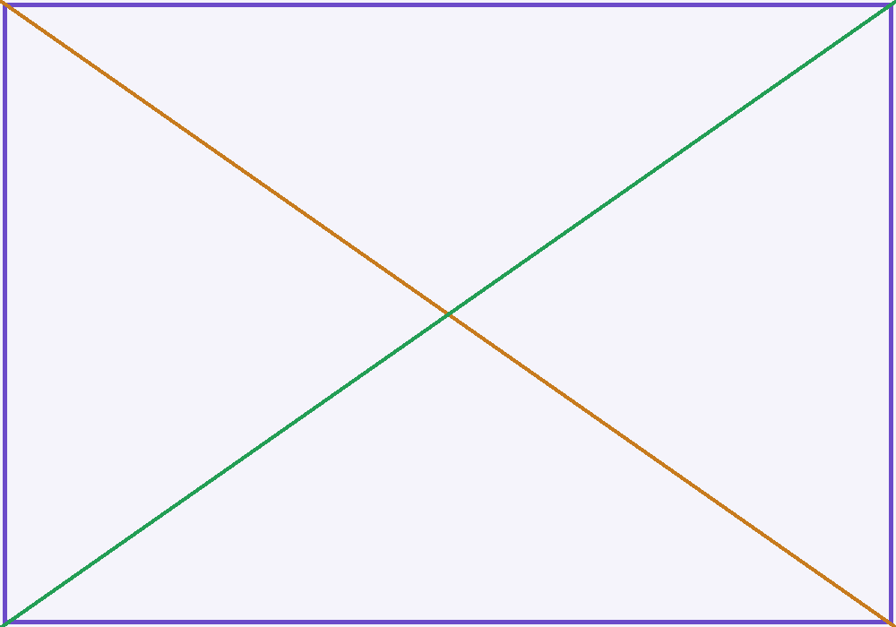

<!-- _class: title -->

###### Project name

# Talk Title Goes Here

## Your Name

DD Month YYYY

<!--
LAYOUT: Title Slide
h6 = eyebrow, h1 = talk title, h2 = author, plain paragraph = date (bottom-left).
Logos are added automatically in the bottom band.
-->

---

# Why this question (Title and Content)

<!-- _footer: "Source: reference, section" -->

- The gold-standard measure is costly and rarely collected
- Routine data is already collected and digitised at scale
- **Question:** can the cheap measurement say what the costly one says?
- A shared data type also allows comparison across settings

---

<!-- _class: compare -->

# Two views of the same thing (Comparison)

<!-- _footer: "Source: reference, section" -->

### Reference data

- Gold-standard measurement
- Accurate
- Costly, rarely collected

### Routine data

- Collected every day
- Available at scale
- Needs a learned mapping to the reference

---

<!-- _class: steps -->

# Weakly supervised learning (numbered steps)

1. One label per sample
2. Split each sample into many pieces
3. Extract features with a pretrained model
4. A small model learns which pieces carry the signal

---

<!-- _class: section -->

###### Key finding

# A headline finding that fits on two lines

---

<!-- _class: caption -->

# The main result (Content with Caption)

<!-- _footer: "Source: reference, figure" -->

Predicted against ground truth on held-out data.

One more sentence on what the figure shows.

---

<!-- _class: two -->

# What was tried (Two Content)

<!-- Two Content: left list uses '-', right list uses '*' so Markdown treats them as two separate lists. -->

- Approach A: marginal gains at best
- Approach B: narrows the gap, lowers the score
- Approach C: a modest gain

* Approach D: the main change
* Best setting and its score
* What it costs in return

---

<!-- _class: side -->

# Two images side by side

---

<!-- _class: picture -->

# Representative image (Picture with Caption)

*One-line caption and attribution here.*

---

<!-- _class: blank -->

<!-- LAYOUT: Blank. Use for a full-slide diagram or figure. -->
