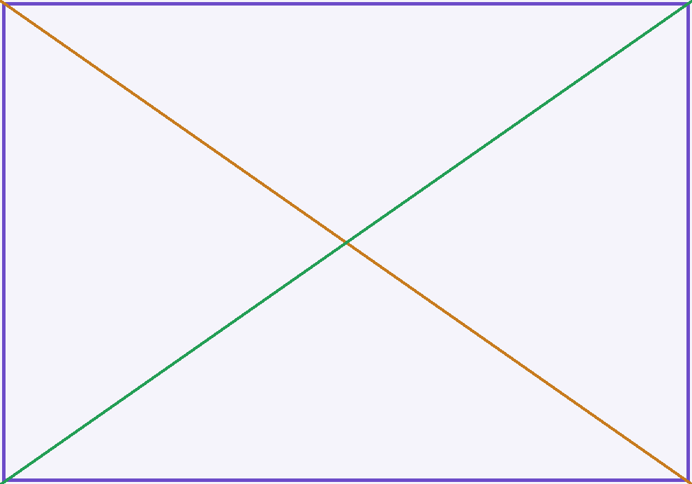

<!-- _class: title -->

# Thesis Title Goes Here

## A subtitle that says what the work does

*One sentence on the method and the question it answers.*

`TALK` Conference talk, DD Month YYYY

**Your Name**\
PhD student — Department, University

---

<!-- _class: tint cards -->

###### Why this question

# One problem, two kinds of data

## The gold-standard measure is costly; routine data is everywhere.

###  Reference data

The gold-standard measurement: accurate, but costly and rarely collected.

###  Routine data

Collected every day, already digitised and available at scale.

###  The bridge

A learned mapping from routine data to the reference measure, trained with weak labels.

> **Question:** can the cheap measurement be made to say what the costly one says?

---

<!-- _class: journey a2 -->

###### Method

# Weakly supervised learning

## One label per sample; the model finds the parts that carry the signal.

1. 

   **Sample**

   One label per sample

2. 

   **Pieces**

   Many per sample

3. 

   **Features**

   Frozen pretrained model

4. 

   **Small model**

   Lightweight prediction head

5. 

   **Scores**

   Continuous, per sample

---

<!-- _class: divider t28 -->

###### 01

### Key finding

# A headline finding that fits on two lines

One sentence on what exposed it and why it matters.

Leads: **Your Name**

---

<!-- _class: dark compare -->

###### Evaluation

# Easy split vs strict split

### ✓ Easy split

- r = 0.00 / 0.00 / 0.00
- Same sources in train and test
- Small train–test gap

### → Strict split

- r = 0.00 / 0.00 / 0.00
- Whole sources held out
- Large train–test gap

> **Placeholder:** the key results panel goes here or on the next slide.

---

<!-- _class: tint chain a3 -->

###### The fix  ·  what was tried

# Where a fix can act

## Data, features, training objective — and what we tested.

###  Data level

Normalise the inputs: a real but modest effect.

###  Feature level

Regularisation narrows the gap but does not recover performance.

###  Training level

An adversarial objective that ignores the source.

###  Outcome

The two objectives trade off; one setting balances them.

---

<!-- _class: caption -->

###### Result

# The main result

Predicted against ground truth on held-out data.

> **Placeholder:** replace with the main figure.

---

<!-- _class: steps a2 -->

###### Next

# What happens next

1. Finish the framework on the current data
2. Test whether the mapping transfers to a new setting
3. Quantify where the two settings diverge

---

<!-- _class: side -->

###### Figures

# Two images side by side

