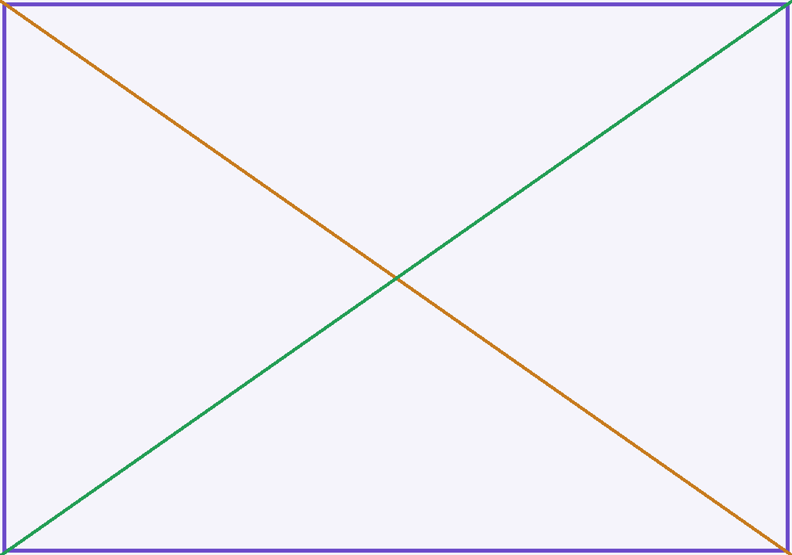

<!-- _class: title -->

# Project

## One-line description of the project

*A strapline: who it is for and why it matters.*

`EXAMPLE` Shows the layouts, not the content

**Presenter name**\
Team — Organisation

---

<!-- _class: tint cards -->

###### What the project does

# Three core capabilities

## A feature row takes 2, 3 or 4 cards and sizes them for you.

###  Collect

Bring data in from every source, checked and described on arrival.

###  Analyse

Run standard workflows at scale without managing the infrastructure.

###  Share

Package results with their context so others can reuse them.

> **Placeholder:** note strips carry the caveat, the open decision or the thing still to be filled in.

---

<!-- _class: journey a3 -->

###### The journey

# Five steps, end to end

## Circles on a rule — the most reused diagram in the deck.

1. 

   **Get access**

   Join a project with a role

2. 

   **Add data**

   Register and upload securely

3. 

   **Check**

   Automatic checks on arrival

4. 

   **Analyse & explore**

   Workflows and interactive views

5. 

   **Export & share**

   Reproducible packages

---

<!-- _class: divider -->

###### 01

### Getting in

# Access and sign-in

Dividers open each section and reset the audience between topics.

Leads: **Name here**

---

<!-- _class: tint chain -->

###### What it contains  ·  The data model

# How the data is organised

## One simple spine — programme down to a single file.

###  Programme

A funded programme or network. Its projects inherit its defaults.

###  Project

Where work lives and access is decided. You are a member, or you see nothing.

###  Dataset

One coherent collection within a project — the unit most questions are counted in.

###  File

One file in a dataset, with its description and checks.

> **Membership-gated:** access is decided at the project. If you are not a member you cannot see the project, its datasets or its files.

---

<!-- _class: rows a2 -->

###### Getting data in

# Four steps from file to platform

## Icon-row list: full-width cards, icon or pill on the left.

-  **Register or join a project** in the web app.
-  **Describe the data** using the template for its type.
-  **Upload** — files go straight to secure storage.
-  **Automatic checks** in staging, then release into the project.

---

<!-- _class: dark compare -->

###### Status

# Where the project is today

### ✓ Working today

- Secure upload and automatic checks
- Storage and access control
- Standard analysis workflows
- Web app and API; packaged export

### → Still maturing

- Fine-grained permissions
- A growing workflow library
- Shared metadata standards
- Wider community and sharing features

---

<!-- _class: tint demo live -->

###### Demo beat

# Run the workflow and watch the checks

`LIVE` Presenter name

### On screen

- Dataset registered in the web app
- Files uploaded
- Check report appears in staging

### What we say

- Files go straight to storage, not through the browser
- Failures stay in staging with a report

> **To prepare:** a test project with a small dataset; a fallback video if the network drops.

---

###### Anything else

# Plain content, with an image that fits

- Bullets use an en-dash, never a literal bullet
- Images are centred and scaled to the space left

---

<!-- _class: side -->

###### Two images

# Side by side, each centred in its half

